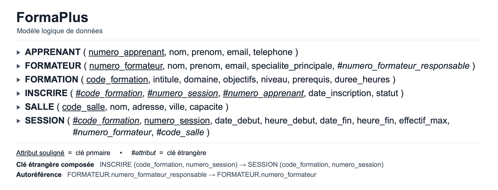

# Projet  — Base de données

## 1. Présentation du projet

FormaPlus est un organisme fictif de formation professionnelle continue en informatique. Il propose des formations courtes en programmation, bases de données et bureautique, organisées en présentiel.

L'objectif de ce projet est de concevoir et développer une base de données en suivant la méthode MERISE.

La base permet de gérer :
- les formations proposées ;
- les sessions de formation ;
- les formateurs et leur encadrement ;
- les apprenants et leurs inscriptions ;
- les salles utilisées.

La paie, la comptabilité et le financement des formations ne sont pas pris en compte.

## 2. Membres du groupe

- Louaï Arichi
- Mustapha Anouar
- Lukyan Robin

## 3. Référence utilisée

Site de référence : https://www.cegos.fr/formations

FormaPlus est un organisme fictif inspiré du secteur de la formation professionnelle. Les règles utilisées sont des hypothèses pédagogiques et ne représentent pas forcément celles de Cegos.

## 4. Analyse des besoins

Pour obtenir les besoins, nous avons utilisé un prompt avec une IA générative.

### Prompt utilisé

Tu travailles dans le domaine de la formation professionnelle continue en informatique. Ton organisme de formation, nommé FormaPlus, propose aux adultes des formations courtes en programmation, bases de données et bureautique, organisées en présentiel.

C'est un organisme fictif inspiré d'un acteur réel comme Cegos. Les données concernent le catalogue des formations, les sessions, les formateurs et leur encadrement, les apprenants, leurs inscriptions et les salles.

Inspire-toi du site https://www.cegos.fr/formations.

Chaque session concerne une seule formation et porte un numéro unique uniquement à l'intérieur de cette formation. Une session ne peut pas exister sans sa formation.

Chaque session est animée par un seul formateur et se déroule dans une seule salle. Les horaires ne doivent pas se chevaucher pour un même formateur ou une même salle.

Un formateur peut encadrer plusieurs collègues, mais ne peut pas être son propre responsable, directement ou indirectement.

Un apprenant peut s'inscrire à plusieurs sessions, mais une seule fois à chaque session.

Le nombre d'inscriptions confirmées ne doit pas dépasser l'effectif maximal ou la capacité de la salle.

Établis les règles de gestion puis un dictionnaire de données contenant entre 25 et 35 données, avec leur signification, leur type et leur taille.

## 5. Règles de gestion

### Formations

- RG01 : FormaPlus propose des formations en programmation, bases de données et bureautique.
- RG02 : Chaque formation possède un code unique, un intitulé, un domaine, des objectifs, un niveau, des prérequis et une durée.
- RG03 : Les niveaux possibles sont débutant, intermédiaire et avancé.
- RG04 : Une formation peut exister sans session et peut avoir plusieurs sessions.

### Sessions

- RG05 : Chaque session concerne une seule formation.
- RG06 : Le numéro d'une session est unique à l'intérieur d'une formation.
- RG07 : Une session possède une date et une heure de début et de fin, ainsi qu'un effectif maximal positif.

### Formateurs

- RG08 : Chaque session est animée par un formateur. Ses sessions ne doivent pas se chevaucher.
- RG09 : Chaque formateur possède un numéro, un nom, un prénom, un email et une spécialité.
- RG10 : Un formateur peut avoir un responsable et encadrer plusieurs formateurs.
- RG11 : Un formateur ne peut pas être son propre responsable et les cycles d'encadrement sont interdits.

### Salles

- RG12 : Chaque session se déroule dans une salle. Une salle peut accueillir plusieurs sessions sans chevauchement.
- RG13 : Chaque salle possède un code, un nom, une adresse, une ville et une capacité positive.

### Apprenants et inscriptions

- RG14 : Chaque apprenant possède un numéro, un nom, un prénom, un email et un téléphone.
- RG15 : Un apprenant peut s'inscrire à plusieurs sessions.
- RG16 : Un apprenant ne peut pas être inscrit deux fois à la même session.
- RG17 : Une inscription possède une date et un statut : en attente, confirmée ou annulée.
- RG18 : Le nombre d'inscriptions confirmées ne doit pas dépasser l'effectif maximal ou la capacité de la salle.

### Périmètre

- RG19 : La comptabilité, la paie et le financement sont exclus.

## 6. Dictionnaire de données

Le dictionnaire contient 30 données.

| Donnée | Type | Taille |
|---|---|---|
| Code formation | Alphanumérique | 10 |
| Intitulé formation | Texte | 100 |
| Domaine | Texte | 30 |
| Objectifs | Texte | 500 |
| Niveau | Texte | 15 |
| Prérequis | Texte | 300 |
| Durée en heures | Entier positif | 3 chiffres |
| Numéro session | Entier positif | 4 chiffres |
| Date début | Date | AAAA-MM-JJ |
| Heure début | Heure | HH:MM |
| Date fin | Date | AAAA-MM-JJ |
| Heure fin | Heure | HH:MM |
| Effectif maximal | Entier positif | 3 chiffres |
| Numéro formateur | Entier positif | 6 chiffres |
| Nom formateur | Texte | 50 |
| Prénom formateur | Texte | 50 |
| Email formateur | Texte | 254 |
| Spécialité | Texte | 100 |
| Numéro apprenant | Entier positif | 8 chiffres |
| Nom apprenant | Texte | 50 |
| Prénom apprenant | Texte | 50 |
| Email apprenant | Texte | 254 |
| Téléphone | Texte | 20 |
| Code salle | Alphanumérique | 10 |
| Nom salle | Texte | 50 |
| Adresse salle | Texte | 150 |
| Ville | Texte | 100 |
| Capacité | Entier positif | 3 chiffres |
| Date inscription | Date | AAAA-MM-JJ |
| Statut inscription | Texte | 10 |

## 7. Modèle conceptuel de données (MCD)

Le MCD a été réalisé avec diagrams.net.


[Fichier source du MCD](MCD_FormaPlus.drawio)

Le modèle contient cinq entités principales : FORMATION, SESSION, FORMATEUR, APPRENANT et SALLE.

SESSION est une entité faible car son numéro est unique seulement à l'intérieur d'une formation.

On retrouve aussi une association récursive ENCADRER sur FORMATEUR.

Le modèle respecte la troisième forme normale (3FN), car les attributs descriptifs dépendent des clés des relations, sans dépendances transitives entre attributs non-clés dans notre modélisation.

## 8. Modèle logique de données (MLD)

Le MLD a été généré avec Mocodo.



Les six relations obtenues sont :

- APPRENANT(numero_apprenant, nom, prenom, email, telephone)
- FORMATEUR(numero_formateur, nom, prenom, email, specialite_principale, numero_formateur_responsable)
- FORMATION(code_formation, intitule, domaine, objectifs, niveau, prerequis, duree_heures)
- SALLE(code_salle, nom, adresse, ville, capacite)
- SESSION(code_formation, numero_session, date_debut, heure_debut, date_fin, heure_fin, effectif_max, numero_formateur, code_salle)
- INSCRIRE(code_formation, numero_session, numero_apprenant, date_inscription, statut)

La clé primaire de SESSION est composée de code_formation et numero_session.

La clé primaire de INSCRIRE est composée de code_formation, numero_session et numero_apprenant.

FORMATEUR possède également une clé étrangère récursive vers son responsable.

## 9. Modèle physique de données (MPD)

Le MPD a été créé avec MySQL.

Le fichier `1_creation.sql` contient les six tables, leurs clés primaires et leurs clés étrangères.

Nous avons utilisé ON DELETE CASCADE, ON DELETE SET NULL, ON DELETE RESTRICT et ON UPDATE CASCADE pour gérer les relations.

Le fichier `2_contraintes.sql` contient 17 contraintes CHECK.

Elles permettent de vérifier :
- les durées positives ;
- les niveaux et domaines autorisés ;
- les effectifs et capacités positifs ;
- les dates de début et de fin ;
- les statuts des inscriptions ;
- les formats simples des emails ;
- certains champs texte non vides.

Certaines règles plus complexes ne sont pas encore gérées automatiquement, notamment les cycles d'encadrement, les chevauchements de sessions et les limites d'inscriptions confirmées.

Elles nécessiteraient des triggers ou des vérifications supplémentaires.

## 10. Insertion des données

Les données ont été générées à l'aide d'un prompt adapté à FormaPlus.

Le prompt est disponible dans `prompt_insertion.txt`.

Les insertions sont disponibles dans `3.insertions.sql`.

Nous avons inséré :

| Table | Nombre de lignes |
|---|---:|
| FORMATION | 12 |
| FORMATEUR | 10 |
| SALLE | 8 |
| APPRENANT | 50 |
| SESSION | 24 |
| INSCRIRE | 100 |
| **Total** | **204** |

Les insertions ont été exécutées dans MySQL et les nombres de lignes ont été vérifiés avec COUNT(*).

## 11. Scénario d'utilisation et interrogation

Le responsable pédagogique de FormaPlus souhaite organiser les sessions de formation entre novembre 2026 et avril 2027.

Il utilise la base pour consulter les formations, organiser les salles et les formateurs, suivre les inscriptions et préparer les convocations.

Il doit également mesurer l'activité par formation et par statut d'inscription, repérer les formations sans session, les formateurs sans affectation et les sessions sans inscription confirmée.

Le fichier [4_interrogation.sql](4_interrogation.sql) contient 22 requêtes.

### Sélections et projections

| Requête | Données recherchées |
|---|---|
| Q1 | Formations pour débutants |
| Q2 | Villes disposant de salles, sans doublons |
| Q3 | Formations contenant SQL dans leur intitulé |
| Q4 | Formations en programmation ou bases de données |
| Q5 | Sessions entre novembre et décembre 2026 |

### Agrégations

| Requête | Données recherchées |
|---|---|
| Q6 | Nombre de sessions par formation |
| Q7 | Capacité totale des salles par ville |
| Q8 | Durées moyennes, minimales et maximales par domaine |
| Q9 | Nombre d'inscriptions confirmées par session |
| Q10 | Nombre d'inscriptions par statut |

### Jointures

| Requête | Données recherchées |
|---|---|
| Q11 | Sessions de programmation au premier trimestre 2027 |
| Q12 | Formations et sessions, y compris les formations sans session |
| Q13 | Salles et sessions, y compris les salles sans session |
| Q14 | Formateurs et leurs responsables |
| Q15 | Apprenants confirmés, formations, sessions et salles |

### Requêtes imbriquées

| Requête | Données recherchées |
|---|---|
| Q16 | Formations ayant une session à Bordeaux |
| Q17 | Formations sans session |
| Q18 | Apprenants ayant une inscription confirmée |
| Q19 | Formateurs sans session |
| Q20 | Formations plus longues qu'au moins une formation de bureautique |
| Q21 | Formations les plus longues de chaque domaine |
| Q22 | Sessions sans inscription confirmée |

Les requêtes utilisent WHERE, ORDER BY, DISTINCT, LIKE, IN, BETWEEN, GROUP BY, HAVING, INNER JOIN, LEFT JOIN, RIGHT JOIN, EXISTS, NOT EXISTS, ANY et ALL.

## 12. Étude des plans d'exécution

Pour cette partie, nous avons choisi la requête Q11, qui recherche les formations en programmation ayant une session entre janvier et mars 2027.

Elle utilise trois opérateurs d'algèbre relationnelle : sélection, projection et jointure.

### Requête utilisée

```sql
SELECT f.code_formation, f.intitule, s.numero_session, s.date_debut
FROM FORMATION AS f
INNER JOIN SESSION AS s ON s.code_formation = f.code_formation
WHERE f.domaine = 'programmation'
AND s.date_debut BETWEEN '2027-01-01' AND '2027-03-31'
ORDER BY f.code_formation, s.numero_session;
```

### Données utilisées

- FORMATION : 12 lignes
- SESSION : 24 lignes
- Formations en programmation : 5 lignes
- Sessions du premier trimestre 2027 : 12 lignes
- Résultat final : 6 lignes

### Comparaison graphique des plans


### Plan A : jointure avant les sélections

Dans le premier plan, on commence par faire la jointure entre FORMATION et SESSION, puis on applique les conditions.

La jointure donne 24 lignes et la sélection conserve les 6 lignes recherchées.

Calcul du coût :

- Jointure : 12 × 24 = 288
- Sélection : 24
- Projection : 6

**Coût total = 318 opérations.**

### Plan B : sélections et projections avant la jointure

Dans le deuxième plan, on filtre les deux tables avant de faire la jointure.

On conserve 5 formations en programmation et 12 sessions sur la période recherchée.

La jointure donne ensuite 6 lignes.

Calcul du coût :

- Sélection FORMATION : 12
- Projection FORMATION : 5
- Sélection SESSION : 24
- Projection SESSION : 12
- Jointure : 5 × 12 = 60
- Projection finale : 6

**Coût total = 119 opérations.**

### Comparaison

| Plan | Coût total | Résultat |
|---|---:|---:|
| Plan A | 318 | 6 lignes |
| Plan B | 119 | 6 lignes |

Le deuxième plan est plus intéressant car il réduit le nombre de lignes avant la jointure.

On économise 199 opérations avec cette méthode de calcul.

Les coûts correspondent à une estimation théorique avec une jointure par boucles imbriquées. Ce ne sont pas les coûts réels calculés par MySQL.

## 13. Bilan critique

La base FormaPlus permet de gérer les principales informations nécessaires à un organisme de formation.

Les tables sont reliées entre elles et les données peuvent être interrogées avec différents types de requêtes SQL.

Les contraintes permettent d'éviter plusieurs erreurs de saisie.

Cependant, certaines améliorations seraient possibles :
- ajouter des triggers pour vérifier les chevauchements de sessions ;
- empêcher automatiquement les cycles entre responsables ;
- contrôler les capacités lors de la confirmation des inscriptions ;
- ajouter une interface pour faciliter l'utilisation de la base.

Le projet nous a permis de revoir les différentes étapes de MERISE, depuis l'analyse des besoins jusqu'à l'interrogation de la base.
